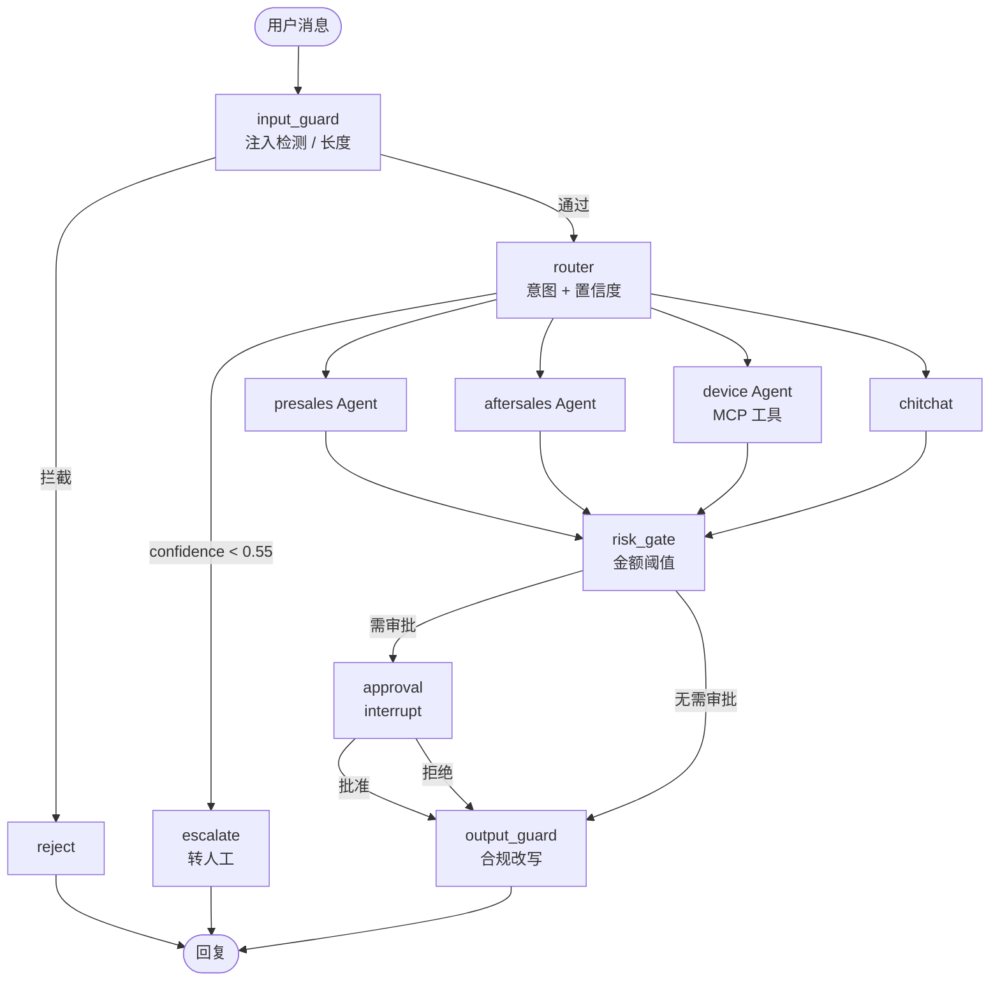

# LangGraph 重构版说明

`langgraph_app/` 是对现有 Agent 体系的一次「同类重写」：**业务流程不变**，编排方式从手写 Runner 换成 LangGraph 状态图，工具换成 LangChain Tool，知识从硬编码 prompt 换成 Skill 文件，设备控制从直接 import 换成 MCP。

原 `src/` 目录保持不动、可继续运行，两者互不依赖。

## 一、改造对照

| 维度 | 原实现（`src/`） | 重构版（`langgraph_app/`） | 换来什么 |
| --- | --- | --- | --- |
| 流程编排 | `Agent` + `Runner` 手写循环，`max_turns=10` | `StateGraph` 显式节点 + 条件边 | 分支可见、可画图、可单点替换 |
| 意图路由 | `RouterAgent` → `IntentRouter` 分类 | `route_node`（LLM 结构化输出，失败回退关键词） | 路由成为图上的一个节点，可观测 |
| 工具调用 | 自建 tool registry + JSON schema | LangChain `@tool` + `create_react_agent` | 工具定义与 schema 自动生成 |
| 领域知识 | 拼在 system prompt 里 | `skills/*/SKILL.md` 渐进式披露 | 改话术不用改代码 |
| 设备控制 | 业务代码直接调脚本 | MCP Client → `mcp_server.py` → miio/yeelight | 硬件与业务解耦，可跨语言 |
| 人工介入 | 异步任务 + 状态表 | `interrupt()` + `Command(resume=...)` | 图状态天然可暂停/恢复 |
| 会话记忆 | Redis + 自建 key | `MemorySaver` checkpointer（`thread_id`） | 演示零依赖，生产可换 Redis/Postgres |

> 只重写「核心逻辑」：鉴权、限流、幂等、审计、数据库这些工程能力仍建议留在原有 `src/api` 层，`langgraph_app` 只负责对话编排。

## 二、目录结构

```
customer-service-bot/
├── langgraph_app/
│   ├── config.py           # 配置（阈值、模型、开关）
│   ├── state.py            # AgentState 定义
│   ├── llm.py              # LLM 构建，无 Key 时返回 None → 离线规则模式
│   ├── guardrails.py       # 输入校验 / PII 脱敏 / 输出合规
│   ├── skill_registry.py   # SKILL.md 解析与按需加载
│   ├── tools.py            # LangChain 工具：订单/物流/退款/退货/知识库/技能
│   ├── nodes.py            # 图节点：路由、风控、审批、输出守卫、领域 Agent
│   ├── graph.py            # 图装配
│   ├── api.py              # FastAPI 入口
│   ├── mcp_servers.json    # MCP 服务器清单（设备控制）
│   └── skills/             # presales / aftersales / return-policy / device-control
└── docs/LANGGRAPH.md
```

## 三、图结构



关键分支：

- **置信度兜底**：`after_route` 比较 `state["confidence"]` 与 `ROUTER_CONFIDENCE_THRESHOLD`（默认 0.55），低于阈值直接进入人工队列，避免「蒙一个意图」。
- **金额审批**：`risk_gate` 检查工具返回的 `[[NEEDS_APPROVAL]]` 标记（退货金额 > 200 元），命中则走 `interrupt()`；`POST /chat/{thread_id}/approve` 恢复执行。
- **输出守卫**：`output_guard` 扫描「保证全额赔付」「100%退款」等禁用话术，命中则替换回复并把会话标记为需人工复核。

## 四、Skill：渐进式披露

`skill_registry.py` 解析 `SKILL.md` 的 YAML frontmatter：

```markdown
---
name: aftersales
description: 售后问题处理：查订单、查物流、退款、退货、改地址
triggers: [退款, 退货, 物流, 没收到, 破损]
---
（正文：处理流程、话术、边界）
```

- 第一级：`catalog()` 只把 `name + description` 放进 system prompt（节省 token）。
- 第二级：Agent 判断需要时调用 `load_skill(name)` 读全文。
- 兜底：无 LLM 时 `match(text)` 按 `triggers` 关键词匹配。

新增技能 = 新建一个目录 + `SKILL.md`，无需改 Python。

## 五、MCP：设备控制

`mcp_servers.json` 声明设备侧 MCP 服务器：

```json
{
  "mcpServers": {
    "device-control": {
      "command": "python",
      "args": ["mcp_server.py"],
      "cwd": "../../MiDeviceController/ControlXiaomiDevices"
    }
  }
}
```

启动时 `get_device_tools()` 用 `langchain-mcp-adapters` 把远端工具转成 LangChain Tool；MCP 不可用则 `device` 意图降级为「设备控制暂不可用」。设备侧实现见 MiDeviceController 仓库的 `mcp_server.py`（7 个工具：列设备、查状态、开关、亮度、色温、模式、档位）。

## 六、运行

```bash
pip install -r requirements-langgraph.txt

# 有模型 Key：走 LLM 路由 + ReAct Agent
export OPENAI_API_KEY=sk-...
export OPENAI_MODEL=gpt-4o-mini
export OPENAI_API_BASE=https://api.openai.com/v1

# 无 Key 也能跑：自动进入离线规则模式（正则解析 + 直接调工具）
python -m langgraph_app
# → http://127.0.0.1:8010/docs
```

## 七、接口

| 方法 | 路径 | 说明 |
| --- | --- | --- |
| GET | `/health` | 健康检查，含 `llm_enabled` |
| POST | `/chat` | `{"text": "...", "customer_id": "cust_001", "thread_id": "t1"}` |
| POST | `/chat/{thread_id}/approve` | `{"approved": true}` 恢复被中断的审批 |
| GET | `/skills` | 列出已加载技能目录 |
| GET | `/mcp/tools` | 列出 MCP 暴露的工具 |
| GET | `/graph` | 返回 Mermaid 图源码 |

示例：

```bash
curl -s http://127.0.0.1:8010/chat -H 'Content-Type: application/json' \
  -d '{"text":"ORD-20251102-002 申请退货","customer_id":"cust_001","thread_id":"t1"}'
# 1299 元超过 200 元阈值 → {"status":"need_approval", ...}

curl -s http://127.0.0.1:8010/chat/t1/approve -H 'Content-Type: application/json' \
  -d '{"approved":true}'
```

## 八、已知取舍

- **内存态**：`MemorySaver` 只适合单进程演示，生产换 `PostgresSaver`/`RedisSaver`。
- **模拟数据**：`tools.py` 里的订单是内存样例（`ORD-20251101-001` 等），真实环境替换为仓储层调用。
- **未做鉴权**：`api.py` 没有 JWT/RBAC，沿用原 `src/api` 的中间件即可。
- **单轮审批**：审批只支持「批准/拒绝」，不支持改金额后重提。
